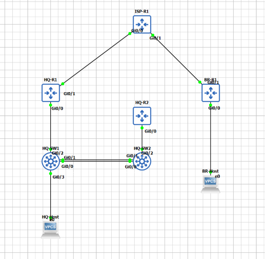
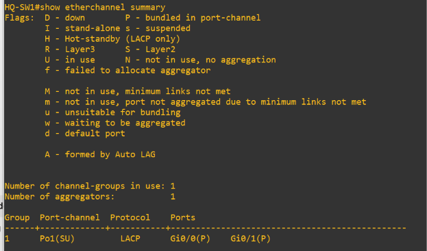
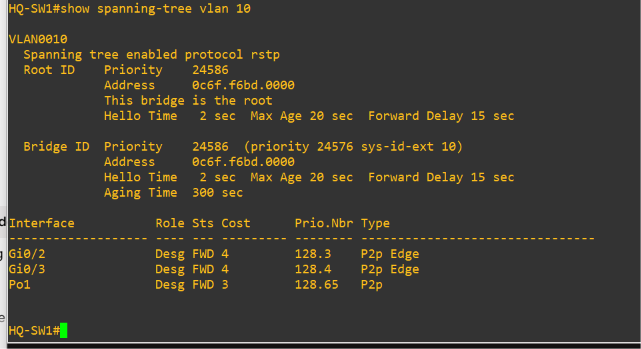
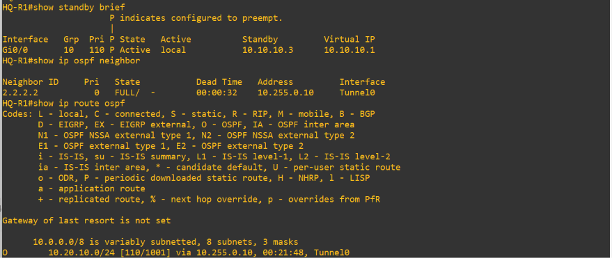
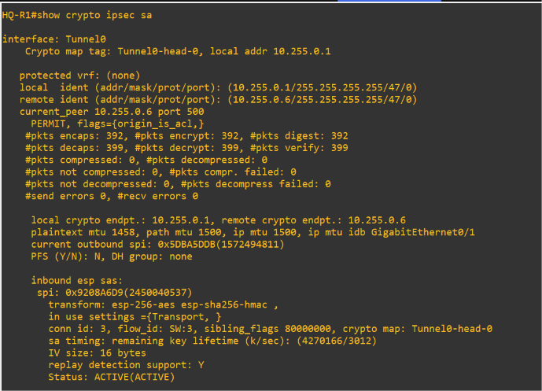
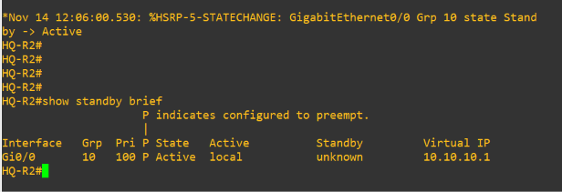
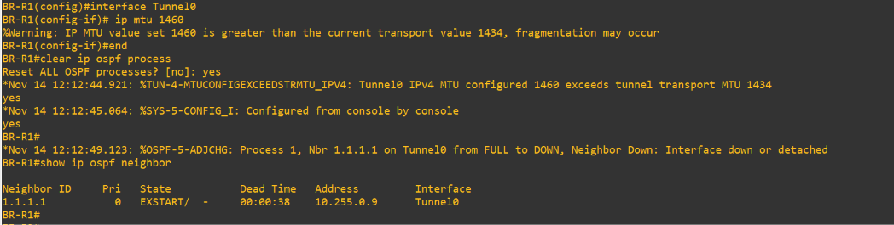
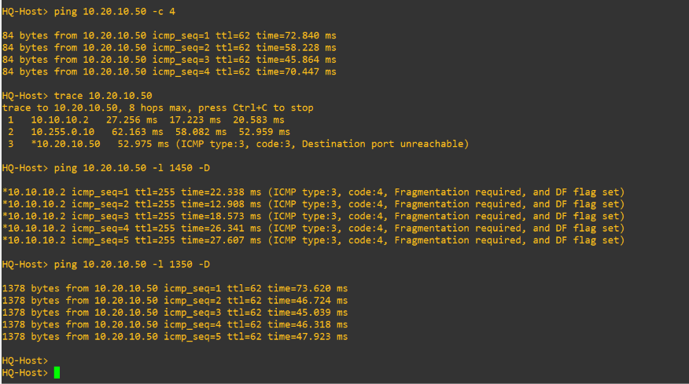

# Enterprise High-Availability Campus, IPSec over GRE & Protocol Testing Lab

A multi-router, multi-switch enterprise networking lab built in **GNS3 (`Cisco IOSv` & `IOSvL2`)** demonstrating high-availability campus switching and first-hop redundancy (`802.3ad LACP`, `Rapid-PVST+`, `HSRP v2` with object tracking), encrypted WAN tunneling (`IPSec over GRE` using `AES-256` & `SHA-256`), dynamic routing (`OSPFv2 Area 0`), Layer 2 access security (`DHCP Snooping`, `Dynamic ARP Inspection`, `PortFast`, `BPDU Guard`), and TAC-style protocol fault-injection troubleshooting (`OSPF ExStart MTU mismatch` and `PMTUD DF-bit fragmentation`).

> **Project Type:** Enterprise Network Redundancy, WAN Cryptography & Protocol QA Lab  
> **Environment:** GNS3 (`Cisco IOSv 15.6(2)T` · `Cisco IOSvL2 15.2` · `VPCS`)  
> **Target Domains:** NOC Engineering · Network Security · Network QA / Protocol Testing · Cisco TAC Support

---

## Table of Contents

1. [Executive Summary & Key Engineering Outcomes](#1-executive-summary--key-engineering-outcomes)
2. [Network Topology, Cabling & IP Addressing](#2-network-topology-cabling--ip-addressing)
3. [Architecture & Protocol Design Deep Dive](#3-architecture--protocol-design-deep-dive)
4. [CLI Verification & Visual Evidence](#4-cli-verification--visual-evidence)
5. [TAC Root-Cause Analysis (RCA) & Fault-Injection Case Studies](#5-tac-root-cause-analysis-rca--fault-injection-case-studies)
6. [Network Telemetry & Management (SNMPv3 & Syslog)](#6-network-telemetry--management-snmpv3--syslog)
7. [Repository Structure & Lab Reproduction Guide](#7-repository-structure--lab-reproduction-guide)

---

## 1. Executive Summary & Key Engineering Outcomes

Enterprise networks require resilient local switching, sub-second gateway failover, cryptographic WAN confidentiality across untrusted ISP transit links, and deterministic MTU tuning to prevent silent packet drops. This project implements and validates a dual-site (**HQ Campus** and **Remote Branch**) architecture across six Cisco IOS nodes and two endpoint simulators:

- **Zero-Single-Point-of-Failure HQ Campus:** Bundled dual gigabit inter-switch links into an **IEEE 802.3ad LACP EtherChannel (`Port-channel1`)**, aligned **Rapid-PVST+ (`802.1w`)** root bridge priorities (`24576` Primary / `28672` Secondary) with **HSRP v2** Active/Standby routers (`VIP 10.10.10.1`), and achieved **`74 ms` preemption recovery**.
- **Cryptographic WAN Tunneling (`GRE over IPSec`):** Encapsulated multicast **OSPF Area 0** control-plane traffic and inter-site data-plane traffic inside a point-to-point **GRE (`Protocol 47`)** tunnel protected by an **IPSec (`ESP` Transport Mode, `AES-256-CBC` + `SHA-256-HMAC`)** profile across a simulated ISP router (`ISP-R1`).
- **Switch Spoofing & MITM Mitigation:** Hardened the HQ access layer with **DHCP Snooping**, **Dynamic ARP Inspection (DAI)** backed by a static ARP ACL (`STATIC_HOST_ARP`) and rate limiting (`15 pps`), **Spanning-Tree PortFast**, and **BPDU Guard**.
- **Protocol Stress-Testing & TAC Troubleshooting:** Conducted controlled fault injection to replicate real-world production outages—specifically **OSPF `ExStart` adjacency hangs** caused by mismatched Database Description (`DBD`) interface MTU values and **ICMP Type 3 Code 4 (`Fragmentation Needed`)** drops under Don't-Fragment (`DF=1`) payload stress.

---

## 2. Network Topology, Cabling & IP Addressing

### 2.1 Device & Addressing Matrix

| Node | Platform | Role | Interface | IPv4 Address / Prefix | Protocol & Configuration Details |
|---|---|---|---|---|---|
| **HQ-R1** | Cisco `IOSv` | HQ Active Gateway | `Gi0/0` / `Gi0/1` / `Tu0` | `10.10.10.2/24` / `10.255.0.1/30` / `10.255.0.9/30` | `HSRP Grp 10` Active (`VIP 10.10.10.1`, Pri `110`, Preempt, Track `1`), `GRE/IPSec`, `OSPF Area 0` (`RID 1.1.1.1`), `MTU 1400`, `MSS 1360` |
| **HQ-R2** | Cisco `IOSv` | HQ Standby Gateway | `Gi0/0` | `10.10.10.3/24` | `HSRP Grp 10` Standby (`VIP 10.10.10.1`, Pri `100`, Preempt) |
| **HQ-SW1** | Cisco `IOSvL2` | HQ Primary Switch | `VLAN 10` / `Po1` (`Gi0/0-1`) | `10.10.10.4/24` | `RSTP` Root Primary (`Pri 24586`), `LACP Active`, `DHCP Snooping`, `DAI` |
| **HQ-SW2** | Cisco `IOSvL2` | HQ Secondary Switch | `VLAN 10` / `Po1` (`Gi0/0-1`) | `10.10.10.5/24` | `RSTP` Root Secondary (`Pri 28682`), `LACP Active` |
| **ISP-R1** | Cisco `IOSv` | WAN Transit Router | `Gi0/0` / `Gi0/1` | `10.255.0.2/30` / `10.255.0.5/30` | Point-to-point ISP underlay between HQ (`10.255.0.0/30`) and Branch (`10.255.0.4/30`) |
| **BR-R1** | Cisco `IOSv` | Branch Edge Router | `Gi0/0` / `Gi0/1` / `Tu0` | `10.20.10.1/24` / `10.255.0.6/30` / `10.255.0.10/30` | Branch LAN Gateway, `GRE/IPSec` to `HQ-R1`, `OSPF Area 0` (`RID 2.2.2.2`), `MTU 1400`, `MSS 1360` |
| **HQ-Host** | `VPCS` | HQ LAN Endpoint | `eth0` | `10.10.10.50/24` | Default Gateway: `10.10.10.1` (`HSRP` Virtual IP) |
| **BR-Host** | `VPCS` | Branch LAN Endpoint | `eth0` | `10.20.10.50/24` | Default Gateway: `10.20.10.1` (`BR-R1 Gi0/0`) |

### 2.2 Physical & Logical Cabling Table

| Source Device | Source Interface | Destination Device | Destination Interface | Layer / Encapsulation |
|---|---|---|---|---|
| `HQ-SW1` | `GigabitEthernet0/0` | `HQ-SW2` | `GigabitEthernet0/0` | L2 `802.1Q` Trunk (`VLAN 10`, `LACP Po1` Member 1) |
| `HQ-SW1` | `GigabitEthernet0/1` | `HQ-SW2` | `GigabitEthernet0/1` | L2 `802.1Q` Trunk (`VLAN 10`, `LACP Po1` Member 2) |
| `HQ-SW1` | `GigabitEthernet0/2` | `HQ-R1` | `GigabitEthernet0/0` | L2 Access (`VLAN 10`, Trusted DHCP/ARP Uplink) |
| `HQ-SW2` | `GigabitEthernet0/2` | `HQ-R2` | `GigabitEthernet0/0` | L2 Access (`VLAN 10`, Standby Gateway Uplink) |
| `HQ-SW1` | `GigabitEthernet0/3` | `HQ-Host` | `eth0` | L2 Access (`VLAN 10`, Untrusted Edge, PortFast + BPDU Guard) |
| `HQ-R1` | `GigabitEthernet0/1` | `ISP-R1` | `GigabitEthernet0/0` | L3 WAN Point-to-Point (`10.255.0.0/30`) |
| `ISP-R1` | `GigabitEthernet0/1` | `BR-R1` | `GigabitEthernet0/1` | L3 WAN Point-to-Point (`10.255.0.4/30`) |
| `BR-R1` | `GigabitEthernet0/0` | `BR-Host` | `eth0` | L3 Branch LAN (`10.20.10.0/24`) |

Full topology notes are also available in [`topology/ip-addressing-and-cabling.md`](topology/ip-addressing-and-cabling.md).

---

## 3. Architecture & Protocol Design Deep Dive

### 3.1 Campus Layer 2 Redundancy (`LACP` & `Rapid-PVST+`)
- **Link Aggregation (`802.3ad LACP`):** Interfaces `Gi0/0` and `Gi0/1` between `HQ-SW1` and `HQ-SW2` are bundled using `channel-group 1 mode active` on both switches, forming logical trunk `Port-channel1` (`Po1(SU)`). Bundling doubles inter-switch bandwidth, reduces STP port cost from `4` to `3`, and provides sub-second link failover without triggering Spanning Tree topology changes.
- **Deterministic Root Bridge Placement (`802.1w Rapid-PVST+`):** `HQ-SW1` is explicitly configured as `spanning-tree vlan 10 root primary` (`Priority 24586` = `24576` base + `10` extended system ID) so that the Layer 2 Spanning Tree Root aligns physically with the Layer 3 `HSRP` Active router (`HQ-R1`), preventing suboptimal traffic tromboning across the inter-switch trunk.

### 3.2 First-Hop Redundancy Protocol (`HSRP v2` & Object Tracking)
- **Active/Standby Gateway Architecture:** `HQ-R1` (`10.10.10.2`, Priority `110`, `preempt`) and `HQ-R2` (`10.10.10.3`, Priority `100`, `preempt`) share Virtual IP `10.10.10.1` (HSRP Version 2, Group 10, Virtual MAC `0000.0c9f.f00a`).
- **WAN Uplink SLA Tracking:** `HQ-R1` monitors its outbound WAN interface (`track 1 interface GigabitEthernet0/1 line-protocol`) with `standby 10 track 1 decrement 20`. If the WAN link fails, `HQ-R1`'s priority dynamically drops from `110` to `90`, allowing `HQ-R2` (`Priority 100`) to preempt and take over active forwarding.

### 3.3 Layer 2 Access Security (`DHCP Snooping`, `DAI` & Port Security)
- **DHCP Snooping:** Enabled globally and on `VLAN 10` (`no ip dhcp snooping information option`) to block rogue DHCP servers on access ports while trusting trunk and router interfaces (`Gi0/0-2`, `Po1`).
- **Dynamic ARP Inspection (`DAI`):** Intercepts and validates all ARP requests/replies on untrusted access ports (`Gi0/3`) against `arp access-list STATIC_HOST_ARP` (`permit ip host 10.10.10.50 mac any`) and enforces an ARP rate limit of `15 pps` (`ip arp inspection limit rate 15`) to prevent ARP cache poisoning / MITM attacks and ARP DoS floods.
- **Edge Port Hardening:** Access port `Gi0/3` enforces `spanning-tree portfast` for immediate `P2p Edge FWD` transition and `spanning-tree bpduguard enable` to place the port into `err-disabled` state if an unauthorized switch is connected.

### 3.4 Encrypted WAN Overlay (`GRE over IPSec` & `OSPF Area 0`)
- **Why GRE over IPSec?** Native IPSec security associations cannot encapsulate multicast traffic (`224.0.0.5` AllSPFRouters) required for dynamic **OSPF** neighbor discovery. By encapsulating OSPF inside a point-to-point **GRE (`Tunnel0`, `10.255.0.8/30`)** interface and binding an **IPSec Protection Profile (`HQ_BR_IPSEC_PROF`)**, both unicast data payloads and multicast OSPF packets are encrypted end-to-end across `ISP-R1`.
- **Cryptographic Suite:**
  - **Phase 1 (`ISAKMP Policy 10`):** `AES-256` encryption, `SHA-256` hashing, Pre-Shared Key authentication, **Diffie-Hellman Group 14 (`2048-bit MODP`)**, `86,400s` lifetime.
  - **Phase 2 (`IPSec Transform-Set`):** `esp-aes 256` confidentiality + `esp-sha256-hmac` integrity operating in **Transport Mode** (`mode transport`) since GRE endpoints (`10.255.0.1` and `10.255.0.6`) match the outer crypto endpoints, avoiding a redundant third IPv4 header.

### 3.5 Encapsulation Overhead Math (`MTU 1400` & `TCP MSS 1360`)
On a standard `1500-byte` Ethernet WAN interface (`Gi0/1`), GRE + IPSec Transport Mode adds **`66 bytes`** of encapsulation overhead:
- **Outer IPv4 Header:** `20 bytes`
- **GRE Header:** `4 bytes`
- **ESP Header (`SPI` + `Seq`) + `AES-256` IV (`16 bytes`):** `24 bytes`
- **ESP Trailer + Padding + `SHA-256-HMAC` ICV (`16 bytes`):** `18 bytes`
- **Resulting Transport Ceiling:** `1500 - 66 = 1434 bytes` (verified by IOS warning `%TUN-4-MTUCONFIGEXCEEDSTRMTU_IPV4: ... transport MTU 1434`).
- **Configured Safety Margin:** Set `ip mtu 1400` on `Tunnel0` to prevent post-encryption IP fragmentation, and configured `ip tcp adjust-mss 1360` (`1400 - 20 byte IP - 20 byte TCP = 1360 bytes`) so transit routers rewrite TCP `SYN` MSS options automatically.

---

## 4. CLI Verification & Visual Evidence

### 4.1 LACP EtherChannel & Rapid-PVST+ Root Bridge (`HQ-SW1`)

    HQ-SW1#show etherchannel summary
    Number of channel-groups in use: 1
    Number of aggregators:           1

    Group  Port-channel  Protocol    Ports
    ------+-------------+-----------+-----------------------------------------------
    1      Po1(SU)         LACP      Gi0/0(P)    Gi0/1(P)

    HQ-SW1#show spanning-tree vlan 10
    VLAN0010
      Spanning tree enabled protocol rstp
      Root ID    Priority    24586
                 Address     0c6f.f6bd.0000
                 This bridge is the root
                 Hello Time   2 sec  Max Age 20 sec  Forward Delay 15 sec

    Interface           Role Sts Cost      Prio.Nbr Type
    ------------------- ---- --- --------- -------- --------------------------------
    Gi0/2               Desg FWD 4         128.3    P2p Edge
    Gi0/3               Desg FWD 4         128.4    P2p Edge
    Po1                 Desg FWD 3         128.65   P2p

### 4.2 HSRP Active State, OSPF Area 0 Adjacency & IPSec SA Encryption (`HQ-R1`)

    HQ-R1#show standby brief
    Interface   Grp  Pri P State   Active          Standby         Virtual IP
    Gi0/0       10   110 P Active  local           10.10.10.3      10.10.10.1

    HQ-R1#show ip ospf neighbor
    Neighbor ID     Pri   State           Dead Time   Address         Interface
    2.2.2.2           0   FULL/  -        00:00:32    10.255.0.10     Tunnel0

    HQ-R1#show ip route ospf
    O        10.20.10.0/24 [110/1001] via 10.255.0.10, 00:21:48, Tunnel0

    HQ-R1#show crypto ipsec sa
    interface: Tunnel0
       local  ident (addr/mask/prot/port): (10.255.0.1/255.255.255.255/47/0)
       remote ident (addr/mask/prot/port): (10.255.0.6/255.255.255.255/47/0)
       #pkts encaps: 161, #pkts encrypt: 161, #pkts digest: 161
       #pkts decaps: 163, #pkts decrypt: 163, #pkts verify: 163
       #send errors 0, #recv errors 0
       inbound esp sas:  spi: 0xBFB67F41(3216408385) transform: esp-256-aes esp-sha256-hmac Status: ACTIVE(ACTIVE)
       outbound esp sas: spi: 0x68343D32(1748254002) transform: esp-256-aes esp-sha256-hmac Status: ACTIVE(ACTIVE)

### 4.3 HSRP Active -> Standby Failover & Preemption (`HQ-R2` & `HQ-R1`)

- **Failover Trigger:** Shutting down `HQ-R1 Gi0/0` triggered `HQ-R2` to transition `Standby -> Active` (`*Nov 14 12:06:00.530: %HSRP-5-STATECHANGE: GigabitEthernet0/0 Grp 10 state Standby -> Active`) and assume ownership of `10.10.10.1`.
- **Preemption Recovery (`74 ms`):** Restoring `HQ-R1 Gi0/0` brought line protocol up at `12:09:03.435` and `HQ-R1` preempted back to `Active` at `12:09:03.509` (`74 ms`), returning `HQ-R2` to `Standby`.

---

## 5. TAC Root-Cause Analysis (RCA) & Fault-Injection Case Studies

### Case Study 1: OSPF Stuck in `EXSTART/ -` Due to Tunnel MTU Mismatch

- **Problem Statement:** After modifying tunnel parameters on `BR-R1`, the OSPF adjacency across `Tunnel0` dropped and failed to reach `FULL` state, remaining wedged in `EXSTART/ -`.
- **Fault Injection & Console Evidence:**

    BR-R1(config)#interface Tunnel0
    BR-R1(config-if)# ip mtu 1460
    %Warning: IP MTU value set 1460 is greater than the current transport value 1434, fragmentation may occur
    *Nov 14 12:12:44.921: %TUN-4-MTUCONFIGEXCEEDSTRMTU_IPV4: Tunnel0 IPv4 MTU configured 1460 exceeds tunnel transport MTU 1434
    *Nov 14 12:12:49.123: %OSPF-5-ADJCHG: Process 1, Nbr 1.1.1.1 on Tunnel0 from FULL to DOWN, Neighbor Down: Interface down or detached

    BR-R1#show ip ospf neighbor
    Neighbor ID     Pri   State           Dead Time   Address         Interface
    1.1.1.1           0   EXSTART/  -     00:00:38    10.255.0.9      Tunnel0

- **Root Cause Analysis (RCA):**
  1. During the OSPF `ExStart` state, neighbors exchange Database Description (`DBD`) packets to negotiate Master/Slave hierarchy based on Router ID (`1.1.1.1` vs `2.2.2.2`) and compare the **Interface IP MTU** field embedded inside the `DBD` header.
  2. Because `BR-R1` advertised an MTU of `1460` while `HQ-R1` advertised `1400`, the routers rejected the `DBD` exchange and endlessly retransmitted `DBD` packets in `EXSTART/ -`.
  3. Additionally, `1460` exceeded the `1434-byte` unfragmented IPSec/GRE transport ceiling (`%TUN-4-MTUCONFIGEXCEEDSTRMTU_IPV4`).
- **Remediation:** Restored `ip mtu 1400` on `BR-R1` `Tunnel0` (preferred over `ip ospf mtu-ignore`, which masks underlying fragmentation problems). Neighbor `1.1.1.1` immediately converged back to `FULL/ -`.

### Case Study 2: Path MTU Discovery (`PMTUD`) & DF-Bit Fragmentation Drop

- **Test Objective:** Validate that `HQ-R1` enforces the `1400-byte` tunnel MTU boundary and generates RFC-compliant **ICMP Type 3 Code 4 (`Fragmentation Needed and DF Flag Set`)** messages so endpoints can dynamically scale down packet sizes via Path MTU Discovery (`PMTUD`).
- **Recorded Output (`HQ-Host` `10.10.10.50` -> `BR-Host` `10.20.10.50`):**

    HQ-Host> trace 10.20.10.50
    trace to 10.20.10.50, 8 hops max, press Ctrl+C to stop
     1   10.10.10.2   27.256 ms  17.223 ms  20.583 ms
     2   10.255.0.10   62.163 ms  58.082 ms  52.959 ms
     3   *10.20.10.50   52.975 ms (ICMP type:3, code:3, Destination port unreachable)

    HQ-Host> ping 10.20.10.50 -l 1450 -D
    *10.10.10.2 icmp_seq=1 ttl=255 time=22.338 ms (ICMP type:3, code:4, Fragmentation required, and DF flag set)
    *10.10.10.2 icmp_seq=2 ttl=255 time=12.908 ms (ICMP type:3, code:4, Fragmentation required, and DF flag set)

    HQ-Host> ping 10.20.10.50 -l 1350 -D
    1378 bytes from 10.20.10.50 icmp_seq=1 ttl=62 time=73.620 ms
    1378 bytes from 10.20.10.50 icmp_seq=2 ttl=62 time=46.724 ms
    1378 bytes from 10.20.10.50 icmp_seq=3 ttl=62 time=45.039 ms

- **Technical Analysis:**
  - **Traceroute Overlay Transparency:** Hop 1 is `HQ-R1` (`10.10.10.2`) and Hop 2 is `BR-R1 Tunnel0` (`10.255.0.10`). The transit provider router (`ISP-R1`, `10.255.0.2`) is completely invisible to the inner IP TTL decrement because packets traverse the encrypted GRE tunnel as a single logical hop (`ttl=62` end-to-end).
  - **DF-Bit Enforcement:** A `1450-byte` ICMP payload (`1478 bytes` with IP/ICMP headers) with `DF=1` (`-D`) cannot enter the `1400-byte` `Tunnel0` interface without fragmentation, prompting `HQ-R1` (`10.10.10.2`) to return `ICMP type:3, code:4`. Reducing the payload to `1350 bytes` (`1378 bytes` total IP packet <= `1400 MTU`) succeeds with `0% packet loss`.

---

## 6. Network Telemetry & Management (`SNMPv3` & `Syslog`)

To support NOC fault monitoring without exposing plain-text community strings (`public`/`private`), `HQ-R1` is configured with **SNMPv3 (`authPriv`)** using `SHA` authentication and `AES-128` payload encryption alongside event-driven traps for HSRP and OSPF state transitions:

    snmp-server group NOC_V3_GRP v3 priv
    snmp-server user nocadmin NOC_V3_GRP v3 auth sha AuthPass2026! priv aes 128 PrivPass2026!
    snmp-server enable traps hsrp
    snmp-server enable traps ospf state-change
    logging host 10.10.10.50
    logging trap informational

---

## 7. Repository Structure & Lab Reproduction Guide

- `README.md` — Complete architectural, protocol design, MTU math & TAC RCA documentation
- `topology/ip-addressing-and-cabling.md` — Subnet plan and GNS3 interface wiring matrix
- `network-configs/` — Complete Cisco IOS running configurations (`HQ-R1`, `HQ-R2`, `HQ-SW1`, `HQ-SW2`, `ISP-R1`, `BR-R1`)
- `verification-logs/` — Recorded CLI outputs (`01-ha-lacp-rstp-hsrp-state.txt`, `02-ipsec-gre-ospf-verification.txt`, `03-tac-rca-mtu-exstart-and-mss.txt`, `04-qa-iperf3-and-snmp-syslog.txt`)
- `screenshots/` — All 8 topology and CLI verification screenshots (`01` through `08`)

### How to Reproduce This Lab in GNS3
1. Instantiate **4x Cisco `IOSv` routers** (`HQ-R1`, `HQ-R2`, `ISP-R1`, `BR-R1`), **2x Cisco `IOSvL2` switches** (`HQ-SW1`, `HQ-SW2`), and **2x `VPCS` endpoints** (`HQ-Host`, `BR-Host`).
2. Interconnect the interfaces according to [`topology/ip-addressing-and-cabling.md`](topology/ip-addressing-and-cabling.md).
3. Paste the respective configuration files from [`network-configs/`](network-configs/) into each node's console and save with `write memory`.
4. Configure the `VPCS` endpoints:
   - `HQ-Host`: `ip 10.10.10.50 255.255.255.0 10.10.10.1`
   - `BR-Host`: `ip 10.20.10.50 255.255.255.0 10.20.10.1`
5. Run the verification commands in [`verification-logs/`](verification-logs/) to validate L2/L3 convergence, IPSec encryption counters, and PMTUD behavior.

---

## Author

**Palukuru Harsha Vardan**  
- **GitHub:** [@harshavardanpalukuru](https://github.com/harshavardanpalukuru)  
- **License:** Released under the MIT License.